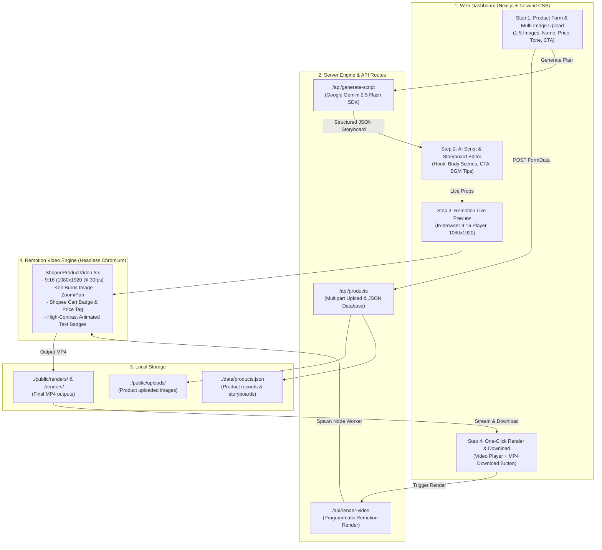

# Shopee Affiliate Video Production System 🎥🛍️
> ระบบสร้างคลิปวิดีโอสั้นป้ายยา Shopee อัตโนมัติ (Short-form 9:16 Video Generator)
> ขับเคลื่อนด้วย **Next.js (App Router) + Remotion Video Engine + Google Gemini AI (@google/genai)**

---

## 🏗️ 1. Architecture Overview (ภาพรวมสถาปัตยกรรมระบบ)



---

## 📁 2. Folder Structure (โครงสร้างโฟลเดอร์)

```
lucid-noether/
├── data/
│   └── products.json                  # Local JSON Database เก็บประวัติสินค้าและ Storyboard
├── public/
│   ├── samples/                       # ภาพตัวอย่างสินค้า (แก้วเก็บความเย็น SVG)
│   ├── uploads/                       # ที่เก็บรูปภาพสินค้าที่ผู้ใช้อัปโหลด (1-5 ภาพ)
│   └── renders/                       # ที่เก็บไฟล์วิดีโอ MP4 ขั้นสุดท้าย (เข้าถึงผ่าน Web ได้)
├── renders/                           # โฟลเดอร์สำเนา MP4 ที่ root directory
├── remotion/                          # Remotion Video Engine
│   ├── components/
│   │   ├── AnimatedTextBadge.tsx      # แถบข้อความแอนิเมชันความคมชัดสูงสไตล์ TikTok/Shopee
│   │   ├── CTAScene.tsx               # ซีนปิดท้าย ชวนกดตะกร้าส้ม (12-15s)
│   │   ├── FeatureScene.tsx           # ซีนนำเสนอจุดเด่นสินค้าทีละข้อ (3-12s)
│   │   ├── HookScene.tsx              # ซีนเปิดคลิปดึงดูดสายตา (0-3s)
│   │   ├── KenBurnsImage.tsx          # แอนิเมชัน Smooth Zoom/Pan (Ken Burns Effect)
│   │   └── ShopeeCartBadge.tsx        # ป้ายตะกร้าส้ม Shopee ติดมุมล่าง พร้อมราคาและปุ่มช้อปเลย
│   ├── Root.tsx                       # Root Composition Configuration (1080x1920, 30fps)
│   ├── ShopeeProductVideo.tsx         # Master Video Composition
│   ├── types.ts                       # TypeScript Interfaces
│   └── utils.ts                       # Remotion Media Resolver
├── scripts/
│   └── render.mjs                     # Standalone CLI Render Worker
├── src/
│   ├── app/
│   │   ├── api/
│   │   │   ├── generate-script/route.ts # Gemini API Call (สร้าง Storyboard & Script)
│   │   │   ├── products/route.ts        # GET/POST อัปโหลดภาพและจัดการสินค้า
│   │   │   └── render-video/route.ts    # Trigger Remotion render programmatically
│   │   ├── globals.css                # Tailwind CSS + Shopee Theme
│   │   ├── layout.tsx                 # Root Layout
│   │   └── page.tsx                   # Main Dashboard UI (4-step workflow)
│   ├── components/
│   │   ├── ProductForm.tsx            # Step 1: ฟอร์มกรอกข้อมูลและอัปโหลดรูป
│   │   ├── ScriptStoryboard.tsx       # Step 2: แก้ไขสคริปต์และ Storyboard จาก AI
│   │   ├── VideoPlayerPreview.tsx     # Step 3: พรีวิววิดีโอสด 9:16 ด้วย Remotion Player
│   │   └── RenderExportModal.tsx      # Step 4: ปุ่มสั่งเรนเดอร์และดาวน์โหลด MP4
│   └── lib/
│       ├── gemini.ts                  # Gemini API SDK (@google/genai) + Fallback Engine
│       └── storage.ts                 # Database helper สำหรับ data/products.json
├── .env.example                       # ตัวอย่าง Environment variables
├── .env.local                         # ไฟล์สำหรับใส่ GEMINI_API_KEY
├── next.config.mjs
├── tailwind.config.ts
├── tsconfig.json
└── package.json
```

---

## ⚡ 3. Quick Start & Setup Instructions

### 1. ติดตั้ง Dependencies
เปิด Terminal ในโฟลเดอร์โปรเจกต์แล้วรัน:
```bash
npm install
```

### 2. ตั้งค่า Gemini API Key
คัดลอกไฟล์ `.env.example` เป็น `.env.local` (สร้างไว้ให้แล้วในโปรเจกต์):
```bash
cp .env.example .env.local
```
เปิดไฟล์ `.env.local` แล้วใส่ API Key ที่ได้รับจาก [Google AI Studio](https://aistudio.google.com/app/apikey):
```env
GEMINI_API_KEY=AIzaSy...ใส่คีย์ของคุณที่นี่...
```
*(หมายเหตุ: หากยังไม่ได้ใส่ API Key หรือไม่มีอินเทอร์เน็ต ระบบมี Built-in Fallback Storyboard Generator ในตัว ทำให้สามารถทดสอบและเรนเดอร์ได้ทันที 100% โดยไม่ error)*

### 3. รัน Development Server
```bash
npm run dev
```
เปิดเบราว์เซอร์ไปที่: **`http://localhost:3000`**

---

## 🎬 4. การทำงานของระบบ (4-Step Workflow)

### Step 1: Input & Data Ingestion (กรอกข้อมูลและอัปโหลดรูป)
- กรอกชื่อสินค้า, ราคาและโปรโมชั่น, จุดเด่น/สโลแกน, สไตล์วิดีโอ (สายป้ายยาตื่นเต้น / มินิมอล / เน้นแก้ปัญหา / จัดโปรลดกระหน่ำ)
- รองรับอัปโหลดรูปภาพสินค้า **1 - 5 ภาพ** (JPG, PNG, WebP)
- มีปุ่ม **"ใช้สินค้าตัวอย่าง"** พรีโหลดภาพแก้วสแตนเลส Tyeso ทันที
- รูปภาพจะถูกบันทึกที่ `./public/uploads` และข้อมูลสินค้าจะบันทึกลง `./data/products.json`

### Step 2: AI Script & Storyboard Generation (Gemini API)
- ระบบส่งข้อมูลไปยัง Google Gemini API (`@google/genai`)
- สร้างโครงสร้างวิดีโอสั้น Shopee 15 วินาที:
  - **Hook (0-3s):** Headline เปิดคลิป + สติกเกอร์เตะตา
  - **Body (3-12s):** นำเสนอ 2-3 จุดเด่นหลัก สลับภาพสินค้าด้วย Ken Burns Effect
  - **CTA (12-15s):** ชี้เป้าตะกร้าส้มซ้ายล่าง + โปรโมชั่นส่งฟรี
  - **Color Palette & Audio Suggestions:** คู่สีและแนวเพลง/ซาวด์เอฟเฟกต์ที่เหมาะกับคลิป
- สามารถแก้ไขข้อความทุกช่องได้สดๆ หรือกดปุ่ม "ให้ Gemini เจนใหม่" ได้ตลอดเวลา

### Step 3: Video Engine (Remotion Live Preview)
- แสดงผลผ่าน `<Player />` ของ Remotion แบบ 9:16 (1080x1920) ตรงกลางหน้าจอ
- สามารถกด **Play / Pause / ขัดขวางไทม์ไลน์** เพื่อดูผลลัพธ์แบบสดๆ ได้ทันทีโดยไม่ต้องรอเรนเดอร์
- มีตะกร้าส้ม Shopee แอนิเมชันลอยอยู่มุมล่าง สอดคล้องกับพฤติกรรมคนดูบน Shopee Video / TikTok

### Step 4: One-Click Render & Export (เรนเดอร์ MP4)
- คลิกปุ่ม **"เริ่มเรนเดอร์วิดีโอ (Render MP4)"**
- Backend รัน Worker ผ่าน Node.js child process เรียก Headless Chromium เรนเดอร์วิดีโอ H.264 1080x1920 30fps
- ไฟล์วิดีโอจะถูกบันทึกที่ `./public/renders/shopee_...mp4` และโฟลเดอร์ `./renders`
- มีวิดีโอพรีวิวพร้อมปุ่ม **"ดาวน์โหลดไฟล์ MP4"** นำไปโพสต์ Shopee Video ได้ทันที

---

## 🛠️ 5. คำสั่งเพิ่มเติมสำหรับ Developer (CLI Commands)

### เรนเดอร์วิดีโอผ่าน CLI:
```bash
# ทดสอบเรนเดอร์ผ่าน Remotion Engine
node scripts/render.mjs

# หรือส่ง props เข้าไปเรนเดอร์
node scripts/render.mjs --props-file .tmp/props_sample.json --output public/renders/custom.mp4
```

### เปิด Remotion Studio GUI (ทดสอบแก้ไข Composition แยก):
```bash
npm run remotion:preview
```
*(จะเปิด Remotion Studio ที่ `http://localhost:3000` หรือ `http://localhost:3100` ให้เล่นแอนิเมชันทีละคีย์เฟรม)*
