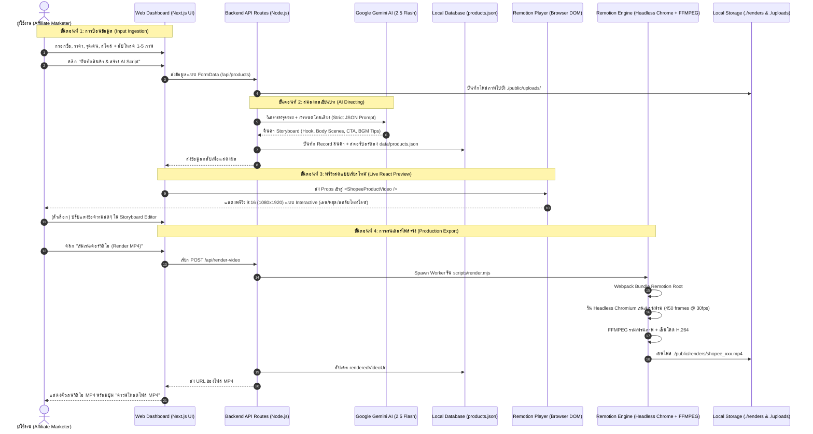

# 📖 เอกสารหลักการทำงานและสถาปัตยกรรมระบบ
## Shopee Affiliate Video Production System (Next.js + Remotion + Google Gemini)

เอกสารฉบับนี้อธิบายถึง **หลักการทำงานเชิงลึก (Core Engineering Principles)**, **สถาปัตยกรรมระบบ (Architecture Pipeline)**, และ **จิตวิทยาการออกแบบวิดีโอสั้น (Short-form Conversion Psychology)** ของระบบผลิตวิดีโอป้ายยา Shopee อัตโนมัติ

---

## 🎯 1. แนวคิดและเป้าหมายการออกแบบ (Design Philosophy)

โดยทั่วไป การทำคลิป Shopee Affiliate หรือ TikTok ป้ายยามี Pain Point สำคัญ 3 ประการ:
1. **เสียเวลาตัดต่อแบบ Manual:** การนำภาพสินค้ามาใส่ใน CapCut หรือ Premiere Pro ทีละคลิป ใช้เวลา 15–30 นาทีต่อคลิป
2. **คิดสคริปต์ไม่ออก:** ขาดเทคนิคการวาง **Hook** ให้หยุดนิ้วคนดูใน 3 วินาทีแรก และขาดการต้อนคนดูไปกดตะกร้าส้มใน 3 วินาทีสุดท้าย
3. **ขยายสเกลไม่ได้ (Non-Scalable):** หากต้องการทำวันละ 20–50 คลิป คนตัดต่อจะไม่สามารถรับโหลดงานไหว

**ระบบนี้จึงถูกออกแบบบนหลักการ "Code-as-a-Video + AI Directing":**
* แปลงภาพและข้อความสินค้าให้เป็นโค้ด **React Component**
* ให้ **Google Gemini AI** รับบทเป็น **ผู้กำกับและคนเขียนบท (Creative Director & Copywriter)**
* ใช้ **Remotion Engine** รับบทเป็น **ห้องเรนเดอร์สตูดิโอ (Video Rendering Pipeline)** ที่วาดเฟรมทีละเฟรมด้วยความแม่นยำระดับ 60–30 fps แล้วบีบอัดเป็น MP4 อัตโนมัติ

---

## 🔄 2. แผนผังลำดับการทำงาน (End-to-End Data Flow Pipeline)



---

## 🧠 3. เจาะลึกกลไกหลักของระบบ (Deep Dive into Core Mechanics)

### 3.1 AI Cognitive Directing (Gemini 2.5 Flash Engine)
การเขียนสคริปต์สั้นไม่ได้ต้องการแค่ข้อความยาวๆ แต่ต้องควบคุม **จังหวะเวลา (Timing Allocation)** และ **โครงสร้างการตลาด (Marketing Structure):**

* **The 3-Second Hook Rule (ช่วง 0–3 วินาที):**
  * *อัลกอริทึมของ TikTok และ Shopee:* จะนับว่าคลิปมีคุณภาพก็ต่อเมื่อคนดูไม่ปัดทิ้งใน 3 วินาทีแรก
  * *Prompt Strategy:* บังคับให้ Gemini สร้าง Headline สั้นเตะตา ไม่เกิน 8 คำ พร้อม Badge สติกเกอร์กระตุ้นความอยากรู้ (Intrigue/Curiosity Hook) เช่น *"แก้วเก็บความเย็นที่ทุกคนตามหา!"* หรือ *"ใครเจอปัญหานี้บ้าง?"*
* **The Body Feature Mapping (ช่วง 3–12 วินาที):**
  * นำจุดเด่นสินค้ามาแยกเป็น 2–3 ซีน โดยแต่ละซีนจะจับคู่กับภาพสินค้า (Image Index 0, 1, 2)
  * แต่ละจุดเด่นจะมีทั้ง **หัวข้อหลัก (Title)** + **คำอธิบายผลลัพธ์ (Benefit)** + **สติกเกอร์การันตี (Sticker)** เช่น `❄️ เก็บเย็น 24 ชม.`
* **The CTA Basket Conversion (ช่วง 12–15 วินาที):**
  * ชี้นิ้วและกระตุ้นการตัดสินใจด้วยโปรโมชั่น (Urgency & Incentive) เช่น ส่งฟรี, ลด 50%, คูปองส่วนลด
  * บังคับให้มีคำว่า **"พิกัดในตะกร้าส้มซ้ายล่าง"** ซึ่งเป็นจุดคลิกหลักของระบบ Shopee Video
* **Smart Fallback Engine (Zero-Downtime Guarantee):**
  * หากผู้ใช้ยังไม่ได้ใส่ `GEMINI_API_KEY` หรือเครือข่ายขัดข้อง ระบบจะไม่ Error แต่จะสลับไปใช้ **Heuristic Template Generator ภาษาไทย** ที่วิเคราะห์โทน (สายป้ายยา / มินิมอล / แก้ปัญหา / แฟลชเซลล์) แล้วสร้างสตอรี่บอร์ดที่สมบูรณ์ให้ทันที

---

### 3.2 Declarative Video Rendering (Remotion Core Engine)

Remotion ไม่ได้ตัดต่อวิดีโอแบบ Timeline-based แบบเดิม แต่ทำงานด้วยหลักการ **"Video = Function of Time"**:
$$\text{Frame State} = f(\text{Frame Number}, \text{Props})$$

#### 1) การคำนวณตำแหน่งและแอนิเมชัน (Interpolation & Springs)
ทุกแอนิเมชันจะถูกคำนวณผ่านเฟรมเรต เช่น ที่ **30 FPS**:
* **Spring Physics:** ใช้ `spring({ frame, fps, config: { damping, stiffness } })` เพื่อสร้างความรู้สึกเด้งดุ๊กดิ๊ก เป็นธรรมชาติ มีแรงเฉื่อย ไม่ใช่เชิงเส้นธรรมดา
* **Ken Burns Effect (Virtual Camera):**
  * กล้องจะค่อยๆ ซูมจาก Scale `1.0` ไป `1.15` และขยับแกน $X$ หรือ $Y$ ด้วยฟังก์ชัน `interpolate()`
  * ช่วยให้ภาพนิ่ง 2D ของสินค้าดูเหมือนกำลังเคลื่อนไหวอยู่ในวิดีโอโปรดักชันหรูหรา

#### 2) Shopee Cart Badge (ตะกร้าส้มลอย)
* ออกแบบด้วยโค้ด SVG และ CSS Flexbox
* วางตำแหน่งที่ **Lower-Third (50px เหนือขอบล่าง)** ซึ่งเป็นจุดที่นิ้วโป้งคนกดได้ง่าย และไม่ทับซ้อนกับ UI ระบบของ TikTok/Shopee
* มีแอนิเมชัน Pulse จังหวะการเต้นของหัวใจ (Heartbeat cycle: `Math.sin(frame)`) ตลอดทั้งคลิป ดึงดูดสายตาคนดูให้มองไปที่ราคาและปุ่มช้อปเลย

#### 3) ความแตกต่างระหว่างพรีวิวสด กับการเรนเดอร์จริง
| คุณสมบัติ | Live Player Preview (Step 3) | Headless MP4 Render (Step 4) |
| :--- | :--- | :--- |
| **เครื่องมือรัน** | `@remotion/player` ในเบราว์เซอร์ | `@remotion/renderer` ผ่าน Headless Chromium |
| **ความเร็ว** | เรียลไทม์ทันที (0 วินาที) | ~15–25 วินาที สำหรับวิดีโอ 15 วินาที |
| **ผลลัพธ์** | HTML5 Canvas / DOM Elements | ไฟล์วิดีโอ MP4 แท้ (Codec H.264 / AAC) |
| **วัตถุประสงค์** | ให้ผู้ใช้ตรวจสอบ/แก้ไขข้อความก่อนเรนเดอร์ | นำไฟล์จริงไปโพสต์ลงโซเชียลมีเดีย |

---

## 📊 4. โครงสร้างข้อมูล (Data Contract Specification)

```typescript
// 1. โครงสร้างสตอรี่บอร์ดที่ Gemini และ Video Engine สื่อสารกัน
interface StoryboardPlan {
  hook: {
    headline: string;      // ข้อความเปิดคลิป (Hook)
    subheadline?: string;  // คำบรรยายรอง
    badgeText?: string;    // สติกเกอร์บนหัว เช่น 🔥 ป้ายยาไอเทมเด็ด
    durationSec: number;   // ความยาว (ปกติ 3 วินาที)
  };
  scenes: Array<{
    highlightTitle: string;// จุดเด่นหลัก
    highlightDesc: string; // คำอธิบายสรรพคุณ
    stickerText?: string;  // สติกเกอร์ย่อย เช่น ✨ คุ้มค่าที่สุด
    imageIndex: number;    // อ้างอิงรูปภาพลำดับที่ 0..4
    durationSec: number;   // ความยาวซีน (ปกติ 3-4 วินาที)
  }>;
  cta: {
    ctaTitle: string;      // ชวนสั่งซื้อ
    ctaSubtitle?: string;  // แจกโค้ดส่งฟรี / ลดเพิ่ม
    buttonText: string;    // ข้อความบนปุ่มช้อป
    basketNote?: string;   // พิกัดตะกร้าส้ม
    durationSec: number;   // ความยาว (ปกติ 3 วินาที)
  };
  theme: {
    primaryColor: string;  // สีแบรนด์ (Shopee Orange #EE4D2D)
    accentColor: string;   // สีเน้น (Gold/Yellow #FFBA00)
    bgColor: string;       // สีพื้นหลัง (#0F172A)
    textColor: string;     // สีตัวอักษร
    styleName?: string;
  };
  audioSuggestion: {
    mood: string;          // อารมณ์เพลง
    musicGenre: string;    // แนวเพลงที่แนะนำ (เช่น TikTok Upbeat Beat)
    soundEffectTips: string;// จังหวะเสียงเอฟเฟกต์ (เช่น เสียง Whoosh, Ding)
  };
}
```

---

## ⚡ 5. ความปลอดภัยและประสิทธิภาพระบบ (Performance & Resilience)

1. **Process Isolation (การแยก Process ทำงาน):**
   * งานเรนเดอร์วิดีโอต้องใช้ CPU และ RAM สูงมาก ระบบจึงไม่รันการเรนเดอร์ใน Main Web Thread ของ Next.js
   * ระบบใช้ `child_process.spawn("node", ["scripts/render.mjs", ...])` รันเป็น Background Worker แยกต่างหาก เพื่อป้องกันไม่ให้หน้าเว็บค้างหรือตอบสนองช้า
2. **Deterministic Fallback (ความพร้อมใช้งาน 100%):**
   * ไม่มีจุดบกพร่องที่ทำให้แอปแครช หากไม่มีภาพ ระบบจะดึงภาพตัวอย่าง SVG มาแทนที่ หากไม่มี API Key ระบบจะใช้ Template Heuristic คุณภาพสูง
3. **Local Storage Privacy (ข้อมูลอยู่บนเครื่องของคุณ):**
   * ภาพที่อัปโหลดและวิดีโอที่เรนเดอร์จะถูกจัดเก็บไว้ในโฟลเดอร์เครื่องของคุณเอง (`./public/uploads` และ `./renders`) ไม่มีการส่งไฟล์ภาพไปยังเซิร์ฟเวอร์ภายนอก ยกเว้นข้อความรายละเอียดที่ส่งไปประมวลผลผ่าน Gemini API

---

## 🚀 6. สรุปคุณค่าของระบบ (Value Proposition)

| มิติ | การทำงานแบบดั้งเดิม (Manual) | ระบบอัตโนมัตินี้ (Automated System) |
| :--- | :--- | :--- |
| **เวลาที่ใช้ต่อ 1 คลิป** | 15 – 30 นาที | **ต่ำกว่า 30 วินาที** |
| **การเขียนสคริปต์/Hook** | ต้องคิดเอง เสี่ยงไม่ดึงดูด | **Gemini AI คิดตามจิตวิทยาการขาย** |
| **ความสม่ำเสมอของแบรนด์** | ขึ้นอยู่กับอารมณ์คนตัดต่อ | **ดีไซน์คมชัด สไตล์ Shopee แท้ 100%** |
| **ต้นทุนต่อคลิป** | ค่าแรงคนตัด 100–300 บาท/คลิป | **ฟรี (รันบนเครื่อง Local)** |
