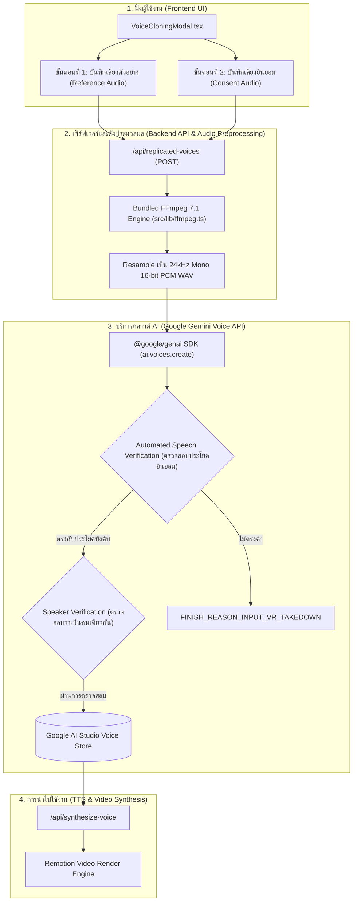

# รายงานระบบโคลนเสียง AI (Voice Replication System Report)
**Shopee Video Generator — ระบบสร้างคลิปวิดีโอป้ายยา Shopee อัตโนมัติ**

---

## 1. บทนำและวัตถุประสงค์ (Executive Summary)

ระบบโคลนเสียง AI ในโปรเจกต์นี้ได้รับการพัฒนาขึ้นเพื่อให้ผู้สร้างเนื้อหา (Affiliate Creators) สามารถสร้าง **"เสียงพากย์อัตลักษณ์เฉพาะตัว (Custom Replicated Voice)"** สำหรับใช้อ่านบทสคริปต์วิดีโอป้ายยาสินค้า Shopee โดยระบบใช้โมเดลล่าสุด **Google Gemini 3.8 Flash TTS (`gemini-3.8-flash-tts`)** ผ่านบริการ **Gemini Voice Replication API** 

จุดเด่นของระบบคือ:
- **ความเป็นธรรมชาติระดับสูง:** ถ่ายทอดน้ำเสียง อารมณ์ และจังหวะการพูดที่ใกล้เคียงกับเจ้าของเสียงจริง
- **การประมวลผลแบบไร้รอยต่อ:** มีระบบแปลงรูปแบบเสียงอัตโนมัติ ไม่ต้องตั้งค่าระบบภายนอกให้ยุ่งยาก
- **ความปลอดภัยและการปกป้องสิทธิ์:** ปฏิบัติตามมาตรฐานความปลอดภัยของ Google อย่างเคร่งครัด ด้วยการฝังลายน้ำดิจิทัล **SynthID** และการตรวจสอบความยินยอมทางกฎหมาย (**Consent Verification Flow**)

---

## 2. สถาปัตยกรรมระบบ (System Architecture)

ระบบประกอบด้วย 4 เลเยอร์หลักที่ทำงานเชื่อมโยงกัน:



---

## 3. ขั้นตอนการโคลนเสียง (Two-Step Cloning Pipeline)

เพื่อให้ Google AI สามารถจำลองเสียงและปฏิบัติตามข้อกำหนดความปลอดภัย ระบบบังคับให้บันทึกไฟล์เสียง 2 ส่วน:

### ขั้นตอนที่ 1: เสียงตัวอย่างการพูด (Reference Audio)
* **วัตถุประสงค์:** ให้โมเดล AI ศึกษาความถี่เสียง (Pitch), เนื้อเสียง (Timbre), และจังหวะการออกเสียง (Cadence)
* **ความยาวที่แนะนำ:** 10 ถึง 30 วินาที
* **เนื้อหาที่พูด:** ผู้ใช้สามารถพูดบทรีวิวธรรมชาติ หรืออ่านบทตัวอย่างภาษาไทยที่ระบบจัดเตรียมไว้ให้
* **เงื่อนไข:** สภาพแวดล้อมเงียบ ไม่มีเสียงเพลงประกอบหรือเสียงพูดแทรก

### ขั้นตอนที่ 2: เสียงยืนยันความยินยอม (Mandatory Consent Audio)
* **วัตถุประสงค์:** เป็นข้อกำหนดความปลอดภัยของ Google เพื่อป้องกันการแอบอ้างนำเสียงผู้อื่นมาโคลนโดยไม่ได้รับอนุญาต
* **ระบบตรวจสอบ:** Google ใช้ระบบ **Automated Speech-to-Text (ASR)** ถอดเสียงเพื่อตรวจว่าคำพูดตรงกับประโยคที่กำหนดหรือไม่ และตรวจ **Biometric Speaker Verification** ว่าเป็นผู้พูดคนเดียวกับขั้นตอนที่ 1 หรือไม่
* **ประโยคบังคับ (Verbatim Consent Phrase):**

| ภาษา | Locale | ประโยคที่ต้องอ่านคำต่อคำ (ห้ามขาด/ห้ามเติมคำ) |
| :--- | :--- | :--- |
| **ภาษาไทย** | `th-TH` | `"ฉันเป็นเจ้าของเสียงนี้ และฉันยินยอมให้ Google ใช้เสียงนี้เพื่อสร้างแบบจำลองเสียงสังเคราะห์"` |
| **ภาษาอังกฤษ** | `en-US` | `"I am the owner of this voice and I consent to Google using this voice to create a synthetic voice model."` |

---

## 4. ปัญหาทางเทคนิคที่พบและแนวทางแก้ไข (Troubleshooting & Solutions)

ระหว่างการพัฒนาและการใช้งานจริง ได้พบและแก้ไขปัญหาสำคัญ 3 ประการดังนี้:

### ปัญหาที่ 1: `ffmpeg is not recognized as an internal or external command`
* **สาเหตุ:** ฝั่งเซิร์ฟเวอร์เรียกคำสั่ง `ffmpeg` ผ่าน shell โดยตรง แต่ในระบบปฏิบัติการ Windows ของผู้ใช้ไม่ได้ติดตั้ง FFmpeg ไว้ใน System PATH
* **การแก้ไข:**
  1. สร้างโมดูล `src/lib/ffmpeg.ts` ที่ตรวจจับไบนารี `ffmpeg.exe` เวอร์ชัน 7.1 ที่ติดตั้งมาพร้อมกับ Remotion (`node_modules/@remotion/compositor-win32-x64-msvc/ffmpeg.exe`) โดยอัตโนมัติ
  2. สั่งรันผ่าน `execFile` พร้อมส่ง arguments แบบ Array เพื่อป้องกันปัญหา Path ที่มีช่องว่าง (White space)
  3. เพิ่มฟังก์ชัน `ensureFfmpegInPath()` เพื่อ inject path เข้า `process.env.PATH` ป้องกันคำสั่ง child process อื่นๆ ทำงานล้มเหลว

---

### ปัญหาที่ 2: `getAudioDurationInSeconds is not defined`
* **สาเหตุ:** ใน `src/lib/tts.ts` มีการเขียน `export { getAudioDurationInSeconds } from "./ffmpeg";` ซึ่งตามมาตรฐาน ES Module ไวยากรณ์นี้ทำหน้าที่ re-export สำหรับผู้เรียกภายนอก แต่ไม่ได้ bind ตัวแปรเข้ามาใน Local Scope ของไฟล์ `tts.ts` เอง เมื่อโค้ดภายในเรียกใช้งานจึงเกิด `ReferenceError`
* **การแก้ไข:** ปรับปรุงให้อยู่ในรูป:
  ```typescript
  import { getAudioDurationInSeconds } from "./ffmpeg";
  export { getAudioDurationInSeconds };
  ```
  ทำให้ใช้งานได้สมบูรณ์ทั้งภายในโมดูลและภายนอก

---

### ปัญหาที่ 3: `Consent flow failed: The recorded phrase didn't match the text on screen (FINISH_REASON_INPUT_VR_TAKEDOWN)`
* **สาเหตุ:** ผู้ใช้อัดเสียงในขั้นตอนที่ 2 ไม่ตรงกับประโยคที่กำหนดคำต่อคำ (เช่น พูดคำทักทายเพิ่มเติม, สรุปความ, นำไฟล์เสียงสินค้ามาใส่ซ้ำ, หรือมีเสียงรบกวนรอบข้างจน AI ตรวจจับคำพูดไม่ผ่าน)
* **การแก้ไข:**
  1. **User Interface:** ปรับปรุง `src/components/VoiceCloningModal.tsx` เพิ่มแท็บสลับภาษาประโยคยินยอม (ไทย/อังกฤษ) และแสดงกล่องข้อความเตือนชัดเจน
  2. **Error Handling:** ปรับปรุง `src/app/api/replicated-voices/route.ts` ให้มีฟังก์ชัน `parseGoogleVoiceError()` คอยแปลง Error ภายในของ Google เป็นข้อความภาษาไทยที่สุภาพ เข้าใจง่าย และระบุขั้นตอนการแก้ไขที่ชัดเจน

---

## 5. ตารางสรุป API Endpoints

| Endpoint | Method | คำอธิบาย | ข้อมูลที่ส่ง/รับ |
| :--- | :--- | :--- | :--- |
| `/api/replicated-voices` | `GET` | ดึงรายชื่อเสียงโคลนทั้งหมดที่บันทึกอยู่ในโปรเจกต์ Google AI Studio | ส่งคืน `{ success: true, voices: [...] }` |
| `/api/replicated-voices` | `POST` | แปลงไฟล์เสียงผ่าน FFmpeg และส่งไปยัง Gemini Voice API เพื่อสร้างโมเดลเสียงใหม่ | รับ `displayName`, `sourceAudio`, `consentAudio` (FormData) |
| `/api/replicated-voices` | `DELETE` | ลบโมเดลเสียงโคลนที่ไม่ต้องการออกจาก AI Studio | ส่ง Query `?id={voiceId}` |
| `/api/synthesize-voice` | `POST` | สังเคราะห์เสียงพูดตามบทสคริปต์ โดยเลือกโมเดลเสียงที่โคลนไว้ได้ | รับ `customText`, `ttsEngine: "gemini"`, `geminiVoice: "{voiceId}"` |

---

## 6. แนวทางปฏิบัติที่ดีที่สุด (Best Practices)

> [!TIP]
> เพื่อให้การโคลนเสียงผ่านในการบันทึกครั้งแรก และได้คุณภาพเสียงที่ดีที่สุด:
> 1. **ใช้ไมโครโฟนตัวเดียวกัน:** บันทึกทั้งขั้นตอนที่ 1 และ 2 โดยใช้ไมโครโฟนเดียวกันและระดับความดังเสียงเท่าเดิม
> 2. **หลีกเลี่ยงเสียงสะท้อน:** บันทึกในห้องที่เงียบ ปิดพัดลม หรือเสียงโทรทัศน์
> 3. **อ่านประโยคยินยอมแบบเป็นธรรมชาติแต่ชัดเจน:** ไม่พูดเร็วหรือช้าเกินไป และห้ามมีคำเกริ่นก่อน/หลังประโยคยินยอม
